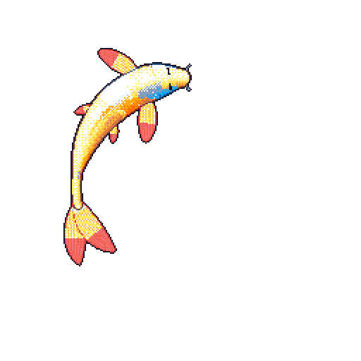
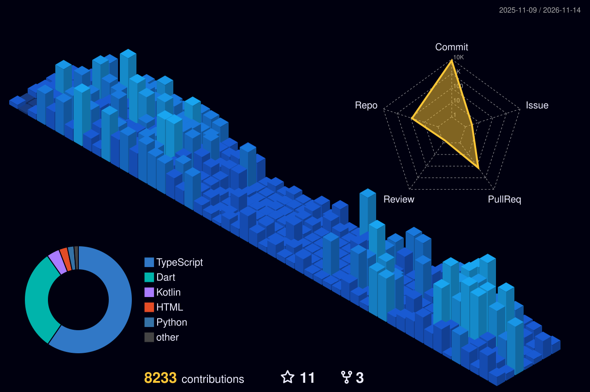

<!-- ╔═══════════════════════════════════════════════════════╗ -->
<!--   R A L E I N  N O V A  —  GITHUB PROFILE README        -->
<!-- ╚═══════════════════════════════════════════════════════╝ -->

<div align="center">

<!-- ░░░ CYBERPUNK GLITCH HEADER ░░░ -->


<br/>

<!-- ░░░ GLITCH-STYLE TYPING ░░░ -->
<a href="https://git.io/typing-svg">
  
</a>

<br/><br/>

<!-- ░░░ SOCIAL & CONTACT BADGES ░░░ -->
<a href="https://ralein.vercel.app/" target="_blank">
  
</a>&nbsp;
<a href="https://www.linkedin.com/in/ralein-nova-r-l-30170b227/" target="_blank">
  
</a>&nbsp;
<a href="mailto:raleinnova@gmail.com">
  
</a>

<br/><br/>

<!-- ░░░ LIVE COUNTERS ░░░ -->
&nbsp;
&nbsp;
&nbsp;


</div>

<br/>
<hr style="border: 1px solid #ff8c0030;" />
<br/>

<!-- ═══════════════════════════════════════════════════════════ -->
<!--                       SYSTEM TERMINAL                     -->
<!-- ═══════════════════════════════════════════════════════════ -->

```text
╭──────────────────────────────────────────────────────────────────────────────╮
│  ralein@quantum-core:~$ neofetch --profile                                   │
├──────────────────────────────────────────────────────────────────────────────┤
│  USER         : Ralein Nova                                                  │
│  ROLE         : Full-Stack Developer · Mobile Architect · AI Engineer         │
│  PASSION      : Cross-Platform Fluid Apps, Generative AI & Assistive Tech    │
│  CURRENTLY    : Building Kynari (AI baby care) & Ravelion AI (3D Studio)     │
│  CORE STACK   : Flutter, Next.js, TypeScript, Python, FastAPI, PyTorch       │
│  STATUS       : Crafting next-generation digital experiences                 │
╰──────────────────────────────────────────────────────────────────────────────╯
```

<br/>
<hr style="border: 1px solid #ff8c0030;" />
<br/>

<!-- ═══════════════════════════════════════════════════════════ -->
<!--                 🎏 LIVING ACTIVITY KOI (GIT-KOI)           -->
<!-- ═══════════════════════════════════════════════════════════ -->

<div align="center">

<h2>

&nbsp;Living Activity Koi
</h2>

<p><em>A procedural pixel-art koi dynamically shaped by public commits, streak momentum, and language colors.</em></p>

<a href="https://github.com/yalongwastaken/git-koi">
  
</a>

<br/><br/>
<sub>Redrawn nightly at midnight UTC via <a href="https://github.com/yalongwastaken/git-koi">git-koi</a> · Motion & size evolve with public activity rhythm</sub>

</div>

<br/>
<hr style="border: 1px solid #ff8c0030;" />
<br/>

<!-- ═══════════════════════════════════════════════════════════ -->
<!--                    FEATURED PROJECTS                      -->
<!-- ═══════════════════════════════════════════════════════════ -->

<div align="center">
<h2>

&nbsp;Featured Repositories & Creations
</h2>
</div>

| Project | Description | Tech Stack |
| :--- | :--- | :--- |
| **[Chef-kiss-flutter](https://github.com/Ralein/Chef-kiss-flutter)** | High-polish culinary companion mobile app featuring interactive recipe exploration, smart dietary filters, and fluid animations. | `Flutter` `Dart` `Mobile UI/UX` |
| **[Ravelion-ai-final](https://github.com/Ralein/Ravelion-ai-final)** | Generative AI & visual computing studio suite featuring background matting, 3D mesh synthesis, and pipeline automation. | `Python` `AI/ML` `FastAPI` `Next.js` |
| **[Miralen-App](https://github.com/Ralein/Miralen-App)** | Assistive accessibility platform translating Morse code and sign language to empower inclusive communication. | `TypeScript` `Next.js` `Accessibility` |
| **[VinR](https://github.com/Ralein/VinR)** | Scalable AI developer engine and containerized intelligent agent execution framework. | `Python` `TypeScript` `Docker` `Shell` |
| **[Vertical.ai](https://github.com/Ralein/Vertical.ai)** | Autonomous enterprise AI workflow orchestration platform with custom tool invocation. | `Next.js` `TypeScript` `AI Agents` |
| **[formcraft-ai](https://github.com/Ralein/formcraft-ai)** | Dynamic schema-driven form generator with drag-and-drop builder, JSON validation, and automated AI schema completion. | `PowerShell` `Next.js` `AI Forms` |
| **[Rosevia-App](https://github.com/Ralein/Rosevia-App)** | Sleek, modern lifestyle and wellness experience built for fluid interaction and responsiveness. | `TypeScript` `React` `Tailwind CSS` |

<br/>
<hr style="border: 1px solid #ff8c0030;" />
<br/>

<!-- ═══════════════════════════════════════════════════════════ -->
<!--                  TECH STACK & ARSENAL                     -->
<!-- ═══════════════════════════════════════════════════════════ -->

<div align="center">

<h2>

&nbsp;Tech Stack & Arsenal
</h2>

<br/>

### ⚡ Languages
<p>
  
  
  
  
  
  
  
  
</p>

### 📱 Frontend & Mobile
<p>
  
  
  
  
  
  
</p>

### ⚙️ Backend, AI & Cloud
<p>
  
  
  
  
  
  
  
  
  
</p>

### 🛠️ Tools & Workflow
<p>
  
  
  
  
  
  
</p>

</div>

<br/>
<hr style="border: 1px solid #ff8c0030;" />
<br/>

<!-- ═══════════════════════════════════════════════════════════ -->
<!--                       3D METRICS                          -->
<!-- ═══════════════════════════════════════════════════════════ -->

<div align="center">
<h2>

&nbsp;Commit Trajectory
</h2>


</div>

<br/>
<hr style="border: 1px solid #ff8c0030;" />
<br/>

<!-- ═══════════════════════════════════════════════════════════ -->
<!--                  CONTRIBUTION SNAKE                       -->
<!-- ═══════════════════════════════════════════════════════════ -->

<div align="center">

<h2>

&nbsp;Activity Matrix
</h2>

<br/>

<picture>
  <source media="(prefers-color-scheme: dark)"  srcset="https://raw.githubusercontent.com/Ralein/Ralein/output/dist/github-snake-dark.svg?v=1"/>
  <source media="(prefers-color-scheme: light)" srcset="https://raw.githubusercontent.com/Ralein/Ralein/output/dist/github-snake.svg?v=1"/>
  
</picture>

</div>

<br/>
<hr style="border: 1px solid #ff8c0030;" />
<br/>

<!-- ═══════════════════════════════════════════════════════════ -->
<!--                  3D CITY BLOCK GRAPH                      -->
<!-- ═══════════════════════════════════════════════════════════ -->

<div align="center">

<h2>

&nbsp;3D City Matrix
</h2>

<br/>

<picture>
  <source media="(prefers-color-scheme: dark)" srcset="https://raw.githubusercontent.com/Ralein/Ralein/output/profile-3d-contrib/profile-night-view.svg"/>
  <source media="(prefers-color-scheme: light)" srcset="https://raw.githubusercontent.com/Ralein/Ralein/output/profile-3d-contrib/profile-green-animate.svg"/>
  
</picture>

</div>

<br/>
<hr style="border: 1px solid #ff8c0030;" />
<br/>

<div align="center">

<br/><br/>


<br/><br/>


</div>
